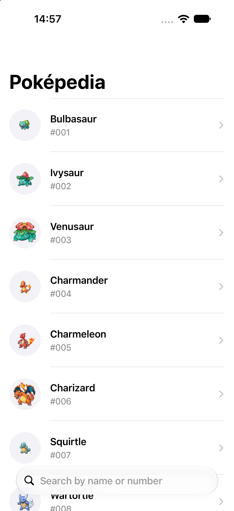
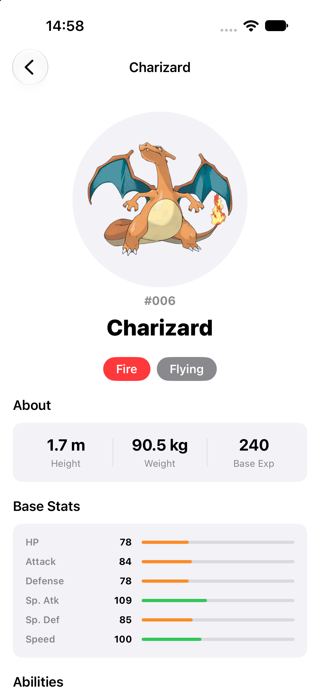

# Poképedia

A native SwiftUI app for browsing Pokémon, searching by name or number, and viewing their details.

  
  

## Public API

The app uses [PokéAPI](https://pokeapi.co/), a free public REST API. No API key or account is required.

## Key decisions

- **Architecture:** The app follows a pragmatic MVVM approach: SwiftUI views render state and forward user intent, while `@Observable`, `@MainActor` view models own presentation state and coordinate asynchronous work. This keeps view code declarative and makes behavior independently testable, following the practical MVVM separation described by [Paul Hudson](https://www.hackingwithswift.com/books/ios-swiftui/introducing-mvvm-into-your-swiftui-project).
- **Data flow:** Each feature has a one-way flow: view action → view model → service → updated view-model state → SwiftUI rendering. The view owns its view model with `@State`, allowing Observation to invalidate only the UI that reads changed state.
- **Dependency injection:** View models receive a `PokemonServiceProtocol` through their initializer rather than constructing a concrete dependency internally. Production uses `PokemonService`; previews and unit tests use `MockPokemonService`.
- **SOLID-inspired design:** Models, networking, caching, and presentation state each have a focused responsibility (Single Responsibility). Depending on `PokemonServiceProtocol`, rather than `PokemonService`, applies Dependency Inversion and keeps the API client replaceable and testable.
- **Protocol-oriented services:** The small service contract describes the app’s required operations, while concrete services and mocks provide interchangeable implementations.
- **Caching:** A concurrency-safe `actor` caches decoded responses in memory by URL for five minutes. Pull-to-refresh clears the cache before loading fresh data.
- **Cancellation:** Networking uses Swift concurrency and `URLSession.data(from:)`. API calls run from SwiftUI's `.task` modifier, so SwiftUI cancels the associated task when its identity changes or the view disappears. Search requests are also debounced by 350 ms; cancellation is treated as an expected state, not an error.
- **Pagination and search:** The list loads 20 Pokémon at a time as the user reaches its end. Local results are filtered immediately, while an online lookup supports Pokémon not yet included in loaded pages.
